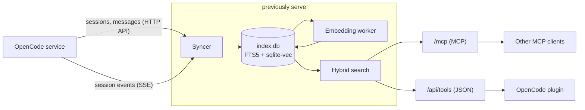

# previously

Search your past [OpenCode](https://opencode.ai) sessions by keyword and by meaning, locally. It indexes
every session the OpenCode background service knows about, keeps the index current as you work, and
answers searches through an MCP server and an OpenCode plugin.

Nothing leaves your machine. Embeddings come from a small ONNX model running on the CPU, and the index is
one SQLite file.

## How it works



`previously serve` is one long-running process. It finds the OpenCode background service the same
way the `opencode` CLI does, then:

- lists every session and syncs the ones that changed since the last run, on start and every ten minutes;
- follows session events (idle, renamed, archived, deleted, compacted, reverted) to resync a session a few
  seconds after it changes;
- reads each session's messages newest first and stops at the first message it already has unchanged, so
  a resync costs one page.

From each message it indexes user prompts, assistant answers, compaction summaries and one line per tool
call (`shell: git status`, `read: src/index.ts`). Tool outputs and injected system instructions are left
out. Text is split into overlapping passages of about 1,500 characters.

Every passage goes into an FTS5 table for BM25 keyword search. Prompts, answers, summaries and titles also
get an embedding from [`bge-small-en-v1.5`](https://huggingface.co/BAAI/bge-small-en-v1.5) in a
[sqlite-vec](https://github.com/asg017/sqlite-vec) table. Tool calls are keyword-only. A search runs both,
fuses the two rankings with reciprocal rank fusion, and groups the passages by session.

The first run reads all your history; a few hundred sessions take a few minutes. Embedding runs in the
background with half your CPU threads, newest passages first, so recent work is searchable straight away.

## Tools

| Tool | What it does |
| --- | --- |
| `search_sessions` | Hybrid, keyword or semantic search. Filters: directory, time range, passage kind, subagents. Returns sessions with matching passages and message IDs. |
| `read_session` | A slice of a transcript, centered on a message or from the start or end. |
| `list_sessions` | Sessions newest first, filtered by title, directory and time. |

Times accept ISO dates (`2026-11-01`) or durations back from now (`12h`, `7d`, `2w`).

## Install

You need [Bun](https://bun.sh) 1.4 or newer and OpenCode 2.2 or newer.

```sh
git clone https://github.com/aronstrandberg/previously
cd previously
bun install
bun link            # puts `previously` in ~/.bun/bin
```

Run the daemon. On Linux with systemd:

```sh
mkdir -p ~/.config/systemd/user
ln -s "$PWD/systemd/previously.service" ~/.config/systemd/user/
systemctl --user daemon-reload
systemctl --user enable --now previously
journalctl --user -u previously -f
```

Elsewhere, run `previously serve` under whatever keeps processes alive for you.

On first start the daemon writes a random bearer token to `~/.local/share/previously/token`
(mode 0600). Clients must send it; the plugin and CLI read it from there.

### OpenCode plugin

Add the checkout to `plugins` in `~/.config/opencode/opencode.jsonc`:

```jsonc
{
  "plugins": ["/path/to/previously"],
}
```

The tools appear in the `previously` namespace. `search_sessions` leaves out the session that calls it.

### Other MCP clients

The MCP endpoint is `http://127.0.0.1:4747/mcp` (Streamable HTTP, stateless). For Claude Code:

```sh
claude mcp add --transport http previously http://127.0.0.1:4747/mcp \
  --header "Authorization: Bearer $(cat ~/.local/share/previously/token)"
```

### CLI

```sh
previously search "why did the collector drop spans" --since 14d
previously search '"connection reset by peer"' --mode keyword
previously read ses_e4308a0f7ffeSZpoxk7YSfmbt9 msg_1b5800855001kxx5WsVTso740b
previously list --title grafana
previously status
```

## Configuration

| Variable | Default | |
| --- | --- | --- |
| `PREVIOUSLY_PORT` | `4747` | Port the daemon listens on |
| `PREVIOUSLY_HOST` | `127.0.0.1` | Address the daemon listens on |
| `PREVIOUSLY_DATA` | `$XDG_DATA_HOME/previously` | Index, token and model cache |
| `PREVIOUSLY_MODEL` | `Xenova/bge-small-en-v1.5` | Also `Xenova/bge-base-en-v1.5`, `Xenova/all-MiniLM-L6-v2` |
| `PREVIOUSLY_THREADS` | half the CPUs | Threads for embedding |
| `TZ` | system zone | Time zone of printed times |

Changing the model re-embeds every passage on the next start. To rebuild the index from scratch, stop the
daemon and delete `index.db`.

The plugin takes `url` and `tokenPath` options for a daemon on another port:

```jsonc
{ "plugins": [{ "package": "/path/to/previously", "options": { "url": "http://127.0.0.1:4848" } }] }
```

## Privacy

The index holds the text of your sessions, which can include anything you pasted into them. It lives in
your data directory with your user's permissions, and the daemon only listens on localhost behind the
bearer token. The model downloads once from Hugging Face into the data directory; after that nothing goes
over the network except calls to your local OpenCode service.

## License

MIT
